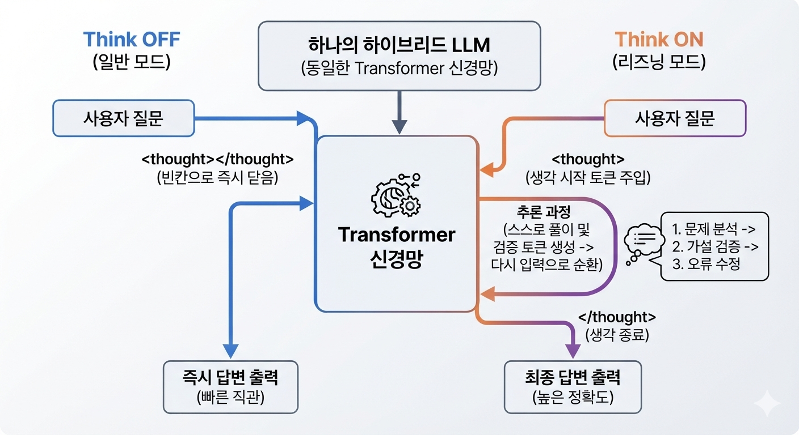

***"LangGraph가 전체 작업 흐름(workflow)을 하나의 상태 머신(State Machine)으로 만들어 준다"***

### 1. 상태 머신(State Machine)이란? ###

쉽게 말해 "현재 상황(State)이 무엇인지 계속 기록하면서, 그 상황에 따라 다음 행동(단계)을 결정하는 시스템"입니다.
* 상태(State): 작업이 진행되면서 계속 업데이트되는 공유 메모장(데이터 바구니)입니다.
  * 예: {고객 메시지, AI 초안, 위험 점수(risk_score), 상담원 연결 여부(requires_human)}
* 단계(Node): 그 메모장을 받아서 각자 할 일을 하고 내용을 업데이트하는 작업자(함수)들입니다.
  * 예: 1번 작업자(초안 작성) → 2번 작업자(score_risk 위험도 평가) → 3번 작업자(상담원 연결 또는 자동 발송)
* 흐름(Edge): 메모장에 적힌 상태를 보고 다음 누구에게 넘길지 결정하는 화살표입니다.
  * 예: requires_human이 True면 상담원 연결 단계로, False면 자동 답변 단계로 이동

### 2. 왜 굳이 "상태 머신"으로 만들까요? ###

일반적인 파이썬 코드로 if-else를 계속 이어 붙이면 흐름이 복잡해질수록 코드가 꼬이기 쉽습니다. LangGraph를 쓰면 다음과 같은 장점이 생깁니다.
`1. 데이터 전달이 깔끔함`: 각 함수(score_risk 등)가 일일이 변수를 주고받지 않고, 하나의 공통 State만 읽고 수정하면 됩니다.
`2. 분기 및 반복 처리`: "위험도가 높으면 사람에게 보내고, 답변이 부실하면 초안 작성 단계로 다시 돌아가라" 같은 복잡한 길찾기(라우팅)를 그림(그래프)처럼 명확하게 짤 수 있습니다.
`3. 진행 상황 추적`: 지금 작업이 어느 단계에 머물러 있는지, 그 시점의 risk_score는 몇 점이었는지 한눈에 파악하고 디버깅하기 쉽습니다.

### 💡 요약 ###

아까 보신 score_risk 함수가 route: "human" 또는 "auto"를 반환했죠? LangGraph는 바로 그 반환된 상태(State)를 보고 다음 실행할 함수를 자동으로 연결해 주는 교통정리 시스템(상태 머신) 역할을 한다는 의미입니다.
